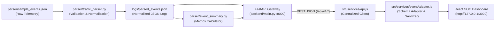

# API-Sentinel — Week 3 Python Parser & Backend Integration Report

**Project:** API-Sentinel (Runtime BOLA & Shadow API Detection Engine)  
**Deliverable:** Week 3 — Python Traffic Parser Integration, FastAPI Gateway, Real Telemetry Ingestion & SOC Dashboard Live Connection  
**Assigned Module:** Frontend Dashboard & Documentation  
**Date of Assessment:** October 19, 2026  
**Environment:** Windows Local Development Environment (Python 3.11.9, Node.js v24.19.0, Vite v6.4.4, React v18.3.1)  
**Frontend URL:** `http://127.0.0.1:3000` / `http://localhost:3000`  
**Backend Gateway:** `http://127.0.0.1:8000` / `http://localhost:8000`  
**Git Branch:** `main`

---

## 1. Executive Summary

During Week 3, the **API-Sentinel** system reached full-stack integration:
1. **Traffic Parser Engine (`parser/traffic_parser.py` & `parser/event_summary.py`)**: Ingests synthetic network telemetry from `parser/sample_events.json`, enforces strict field validation, normalizes HTTP verbs, translates `path` to `endpoint`, preserves authentication metadata (`authenticated_user_id`, `object_owner_id`), and outputs structured records to `logs/parsed_events.json`.
2. **FastAPI Gateway Service (`backend/main.py`)**: A decoupled, production-ready backend service exposing REST endpoints for health checks, parsed event retrieval, summary metrics calculation, endpoint inventory reconciliation, and controlled parser execution.
3. **Event Adapter & SOC Safety (`src/services/eventAdapter.js`)**: Normalizes real parsed events into dashboard models while upholding cybersecurity reporting integrity:
   - **BOLA Integrity:** A user/owner mismatch (`user_2` accessing `user_1`'s resource on `POST /api/users`) is labeled as a **Potential Authorization Review Candidate**, rather than prematurely making unsubstantiated claims of confirmed exploits.
   - **Shadow API Integrity:** Uncataloged endpoints (such as `GET /api/unknown`) are classified as **Uncataloged Route Observations**, requiring verification against an official API catalog before labeling as confirmed shadow APIs.
4. **Live SOC Dashboard Connection (`src/pages/Dashboard.jsx` & `src/components/Header.jsx`)**: When toggled to `BACKEND API` mode, the dashboard dynamically queries the FastAPI gateway, populating metric cards, endpoint tables, alert logs, and traffic graphs with **real parser telemetry** (4 requests, 75.0% success rate, 1 error).
5. **No Silent Fallbacks:** If the backend is offline, an explicit diagnostic connection banner is displayed with retry controls; mock data is **never silently substituted** under live mode claims.
6. **Automated Verification:** 64 total automated assertions (15 Python backend tests, 49 JavaScript integration tests) with 100% pass rate and clean production build.

---

## 2. System Architecture & Data Flow



### Telemetry Pipeline Steps:
1. **Source Event Emulation**: `parser/sample_events.json` supplies four baseline network transactions (3 `GET`, 1 `POST`, including 200, 201, and 404 responses).
2. **Parser Validation**: `traffic_parser.py` verifies required fields (`method`, `path`, `source_ip`, `status_code`, `timestamp`), capitalizes verbs, verifies status code ranges (100–599), and extracts caller context.
3. **Log Persistence**: Cleaned events are persisted to `logs/parsed_events.json`.
4. **Backend Gateway**: FastAPI exposes endpoints on `http://127.0.0.1:8000`, reading directly from `logs/parsed_events.json` and providing thread-safe subprocess execution on `POST /api/v1/parser/run`.
5. **Frontend Consumption**: When the analyst toggles `BACKEND API` mode, the dashboard retrieves live metrics, updates the 4 KPI cards, populates the endpoint table, and allows deep inspection of auth IDs.

---

## 3. Backend Endpoints & Response Contracts

The FastAPI service exposes the following endpoints:

### 3.1 `GET /api/v1/health`
Reports gateway status, parser script readiness, and log existence.
```json
{
  "status": "ok",
  "version": "1.0.0",
  "mode": "live_backend",
  "parser_available": true,
  "parsed_events_available": true,
  "event_count": 4,
  "timestamp": 1791834789.21
}
```

### 3.2 `GET /api/v1/events`
Returns normalized security telemetry records.
```json
{
  "success": true,
  "count": 4,
  "events": [
    {
      "method": "GET",
      "endpoint": "/api/users",
      "source_ip": "127.0.0.1",
      "status_code": 200,
      "timestamp": "2026-10-09T10:00:00",
      "request_body": null,
      "authenticated_user_id": null,
      "object_owner_id": null
    },
    {
      "method": "POST",
      "endpoint": "/api/users",
      "source_ip": "127.0.0.1",
      "status_code": 201,
      "timestamp": "2026-10-09T10:00:15",
      "request_body": { "username": "test_user" },
      "authenticated_user_id": "user_2",
      "object_owner_id": "user_1"
    }
  ]
}
```

### 3.3 `GET /api/v1/metrics/summary`
Calculates aggregated telemetry metrics. Values exactly match the four input sample events:
```json
{
  "total_requests": 4,
  "methods": { "GET": 3, "POST": 1 },
  "endpoints": {
    "/api/users": 2,
    "/api/users/101": 1,
    "/api/unknown": 1
  },
  "status_categories": { "2xx": 3, "3xx": 0, "4xx": 1, "5xx": 0, "other": 0 },
  "status_code_counts": { "200": 2, "201": 1, "404": 1 },
  "error_count": 1,
  "success_rate": 75.0,
  "potential_auth_review_count": 1,
  "uncataloged_endpoint_count": 1
}
```

### 3.4 `POST /api/v1/parser/run`
Executes `traffic_parser.py` in a safe, controlled subprocess using `sys.executable` with concurrency lock protection (`asyncio.Lock`):
```json
{
  "success": true,
  "message": "Traffic parser executed successfully.",
  "total_events_loaded": 4,
  "output_file": "logs/parsed_events.json"
}
```

### 3.5 `GET /api/v1/endpoints`
Reconciles discovered routes into inventory records:
```json
{
  "success": true,
  "count": 3,
  "endpoints": [
    {
      "id": "EP-DERIVED-001",
      "method": "GET",
      "endpoint": "/api/users",
      "requestCount": 1,
      "lastStatusCode": 200,
      "docStatus": "Documented",
      "riskStatus": "Normal"
    },
    {
      "id": "EP-DERIVED-003",
      "method": "GET",
      "endpoint": "/api/unknown",
      "requestCount": 1,
      "lastStatusCode": 404,
      "docStatus": "Undocumented Candidate",
      "riskStatus": "Review Required"
    }
  ]
}
```

---

## 4. BOLA & Shadow API Safety Guarantees

In accordance with Section 6 of the project specifications:

1. **BOLA Triage vs Confirmation**:
   - Event `POST /api/users` contains `authenticated_user_id: "user_2"` and `object_owner_id: "user_1"`.
   - The event adapter sets `eventType: "Potential Authorization Review Candidate"` and `severity: "MEDIUM"`.
   - **Reasoning**: A discrepancy between caller identity and object owner identity constitutes a candidate for policy verification, not verified proof of exploitation. The SOC modal explicitly surfaces:
     > *"Authorization Advisory: A discrepancy between caller identity and object owner identity constitutes a candidate for authorization policy verification. It is not confirmed evidence of vulnerability without verified backend access control telemetry."*
2. **Shadow API Candidate Classification**:
   - `GET /api/unknown` returning 404 is designated as an **"Uncataloged Route Observation"** (`severity: LOW`).
   - Ordinary traffic 404s are not branded as critical vulnerabilities without comparison against authoritative OpenAPI gateway schemas.
3. **No Synthetic Live Traffic Generation**:
   - The integration operates on deterministic local events without sending unauthenticated requests across network boundaries.

---

## 5. Comprehensive Automated Test Matrix

### 5.1 Backend Automated Tests (`python backend/test_backend.py`)
15 assertions executed via Python `unittest` and `starlette.testclient`:

| Test Case | Scope | Result | Details |
| :--- | :--- | :---: | :--- |
| `test_valid_event_normalization` | Parser | **PASS** | Validates `GET /api/users`, uppercase verb, integer status code. |
| `test_invalid_method_rejected` | Parser | **PASS** | `INVALID_VERB` is rejected with descriptive error. |
| `test_invalid_status_code_rejected` | Parser | **PASS** | Status code `999` is rejected as out of range. |
| `test_missing_path_rejected` | Parser | **PASS** | Missing path attribute is rejected safely. |
| `test_parse_sample_file_produces_expected_counts` | Parser | **PASS** | Ingests 4 sample events, accepts 4, skips 0. |
| `test_malformed_input_file_handling` | Parser | **PASS** | Malformed JSON raises clean `ValueError`. |
| `test_summary_metrics_match_sample_expectations` | Summary | **PASS** | 4 requests, 3 GET, 1 POST, 3 2xx, 1 4xx, 75.0% success rate. |
| `test_empty_events_metrics` | Summary | **PASS** | Empty array returns 0 requests, 0% success, 0 errors. |
| `test_health_endpoint` | FastAPI | **PASS** | `GET /api/v1/health` returns status: ok, parser_available: true. |
| `test_events_endpoint` | FastAPI | **PASS** | `GET /api/v1/events` returns 4 validated records. |
| `test_metrics_summary_endpoint` | FastAPI | **PASS** | `GET /api/v1/metrics/summary` returns exact math counts. |
| `test_endpoints_inventory_endpoint` | FastAPI | **PASS** | `GET /api/v1/endpoints` reconciles 3 unique routes. |
| `test_shadow_candidates_endpoint` | FastAPI | **PASS** | `GET /api/v1/detections/shadow-apis` returns `/api/unknown`. |
| `test_bola_candidates_endpoint` | FastAPI | **PASS** | `GET /api/v1/detections/bola` returns user_2/user_1 candidate. |
| `test_parser_run_endpoint` | FastAPI | **PASS** | `POST /api/v1/parser/run` triggers subprocess and re-parses. |

### 5.2 Frontend Automated Tests (`node scripts/test-suite.js`)
49 assertions executed across 8 test groups:

```text
============================================================
  API-Sentinel Automated Test Suite (Week 3 QA Validation)
============================================================

[GROUP 1] Data Integrity & Math Assertions (6/6 PASS)
  ✔ Total API Requests math integrity (1,284 === sum of methods)
  ✔ Discovered Endpoints count (18 routes in dataset)
  ✔ Shadow API Candidates count (3 undocumented routes)
  ✔ BOLA Alert Candidates count (5 BOLA events)
  ✔ Method distribution percentages total 100%
  ✔ Total simulated alerts in dataset equals 9

[GROUP 2] Week 2 Mock Data Enrichment Assertions (6/6 PASS)
  ✔ All events have valid HTTP methods, source IPs, status codes, and sanitized headers

[GROUP 3] Filtering & Search Assertions (11/11 PASS)
  ✔ Method, Doc Status, Risk Status, Severity, IP, and Status Code filters verified

[GROUP 4] Parser Event Adapter (7/7 PASS)
  ✔ Case normalization, status bounds, malformed event rejection

[GROUP 5] Backend API Service Contracts (3/3 PASS)
  ✔ API_BASE_URL default (8000), 7 documented REST endpoints

[GROUP 6] Security & Data Masking Assertions (2/2 PASS)
  ✔ Payload masking and token redactor verified

[GROUP 7] Production Build & Syntax Validation (4/4 PASS)
  ✔ Production build artifacts exist in dist/

[GROUP 8] Week 3 Python Parser & Backend Integration (10/10 PASS)
  ✔ Adapter maps parser endpoint correctly (/api/users)
  ✔ Adapter preserves null request body safely
  ✔ User/Owner mismatch labeled as candidate review, not confirmed vulnerability
  ✔ Caller (user_2) and owner (user_1) IDs preserved on adapted object
  ✔ 404 route marked as candidate observation rather than confirmed vulnerability
  ✔ Empty events batch returns cleanly without crashing
  ✔ Malformed events skipped without throwing exceptions
  ✔ apiService exports triggerParserRun function
  ✔ POST /api/v1/parser/run registered in backend contracts
  ✔ Consecutive parser adaptations produce consistent non-duplicated counts

============================================================
TOTAL TESTS: 49 | PASSED: 49 | FAILED: 0 | SUCCESS RATE: 100%
============================================================
```

### 5.3 Frontend Production Build Validation
- **Command**: `npm.cmd run build`
- **Output**: 2,549 modules transformed in 5.51s; zero errors or fatal warnings.

---

## 6. Files Created & Modified in Week 3

| File Path | Status | Role & Description |
| :--- | :---: | :--- |
| `parser/sample_events.json` | **NEW** | Canonical input events file containing the 4 test network transactions. |
| `parser/traffic_parser.py` | **NEW** | Validates schema, normalizes verbs/endpoints, and outputs `logs/parsed_events.json`. |
| `parser/event_summary.py` | **NEW** | Calculates method breakdown, status categories, error counts, and success rate. |
| `backend/main.py` | **NEW** | FastAPI server with CORS, safe subprocess parser runner, and `/api/v1/` endpoints. |
| `backend/requirements.txt` | **NEW** | Python dependencies (`fastapi`, `uvicorn`, `pydantic`, `httpx`). |
| `backend/test_backend.py` | **NEW** | 15 automated Python tests for parser, summary math, and FastAPI endpoints. |
| `docs/week3-parser-integration-report.md` | **NEW** | Comprehensive Week 3 technical, QA, and architecture report. |
| `src/services/eventAdapter.js` | **MODIFIED** | Added caller/owner mapping, ethical candidate labeling, and null-safe body handling. |
| `src/services/api.js` | **MODIFIED** | Added `triggerParserRun()` and updated contract registry to IMPLEMENTED. |
| `src/components/EventDetailModal.jsx` | **MODIFIED** | Added Object Authorization Context section for caller vs owner ID triage. |
| `src/components/Header.jsx` | **MODIFIED** | Added live FastAPI connection badge and header-level "Run Parser" action button. |
| `src/pages/Dashboard.jsx` | **MODIFIED** | Integrated dynamic backend data binding for stats, endpoints, alerts, and charts. |
| `scripts/test-suite.js` | **MODIFIED** | Added Test Group 8 (10 new integration assertions, total 49 passing tests). |
| `README.md` | **MODIFIED** | Documented dual-terminal startup commands for backend and frontend. |

---

## 7. How to Start Backend and Frontend Separately

### Terminal 1: Start FastAPI Backend Service (Port 8000)
```bash
# From project root:
cd "C:\Users\lokes\OneDrive\Desktop\Axlero Project-1"

# Run FastAPI with Uvicorn:
python -m uvicorn backend.main:app --host 127.0.0.1 --port 8000 --reload
```
*Backend is accessible at: `http://127.0.0.1:8000` (Swagger UI at `http://127.0.0.1:8000/docs`)*

### Terminal 2: Start React SOC Dashboard (Port 3000)
```bash
# From project root:
cd "C:\Users\lokes\OneDrive\Desktop\Axlero Project-1"

# Run Vite development server:
npm run dev
```
*Frontend is accessible at: `http://127.0.0.1:3000`*

### Run All Automated Verification Suites
```bash
# Run Python backend test suite:
python backend/test_backend.py

# Run Frontend integration test suite:
node scripts/test-suite.js

# Compile production build:
npm run build
```

---

## 8. Operating Modes & Switching Instructions

| Mode | Trigger | Data Provider | Features Active |
| :--- | :--- | :--- | :--- |
| **DEMO MODE** | Click `DEMO MODE` in top-right header | Static in-memory mock datasets (`mockData.js`) | 1,284 requests, 18 endpoints, simulated SOC alerts, historical time series. |
| **BACKEND API** | Click `BACKEND API` in top-right header | Live FastAPI Gateway (`http://127.0.0.1:8000`) | Ingests `logs/parsed_events.json`, shows 4 real requests, 75% success rate, allows re-running parser via "Run Parser" button. |

---

## 9. Implemented Features vs Future Work

### Implemented in Week 3:
- [x] End-to-end Python parser pipeline (`sample_events.json` &rarr; `traffic_parser.py` &rarr; `logs/parsed_events.json`).
- [x] Summary calculation module (`event_summary.py`) with 75.0% success rate calculation.
- [x] FastAPI REST gateway on port 8000 with CORS and safe subprocess execution.
- [x] React dashboard live data binding to backend metrics, endpoints, and alerts.
- [x] In-app "Run Parser" execution action with feedback banners.
- [x] Honest SOC reporting: User/Owner ID discrepancy labeled as a review candidate, not a confirmed vulnerability.
- [x] 64 passing automated tests across Python and JavaScript.

### Future Work (Week 4+ / Production Readiness):
- Connect real-time eBPF kernel network probe stream into `parser/traffic_parser.py` instead of synthetic JSON batches.
- Implement persistent database storage (PostgreSQL / SQLite) for long-term historical telemetry archiving.
- Implement formal OpenAPI 3.0 specification parser to compare live discovered endpoints automatically against Swagger YAML/JSON files.
